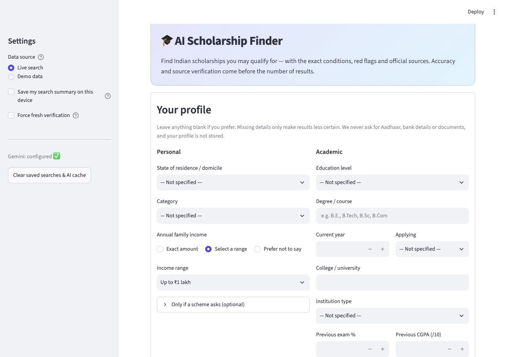
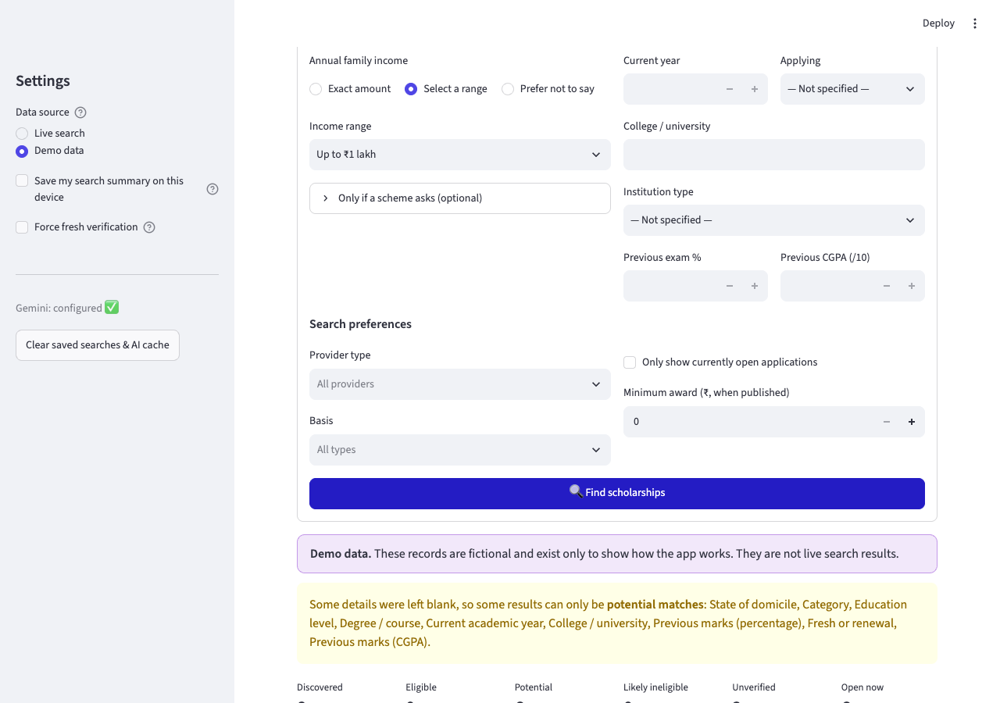
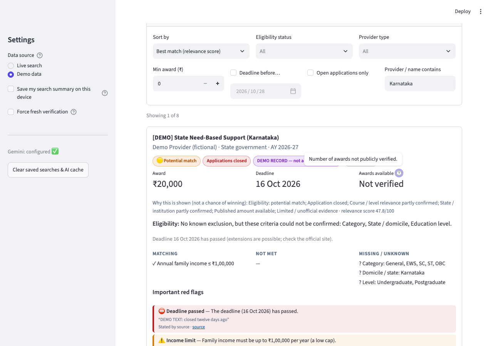
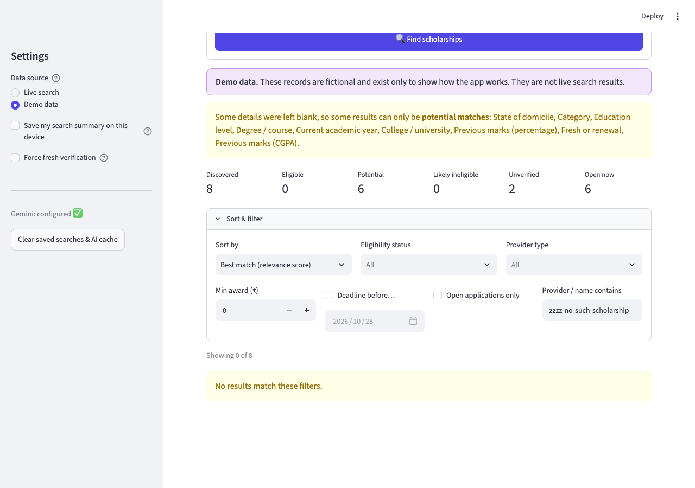
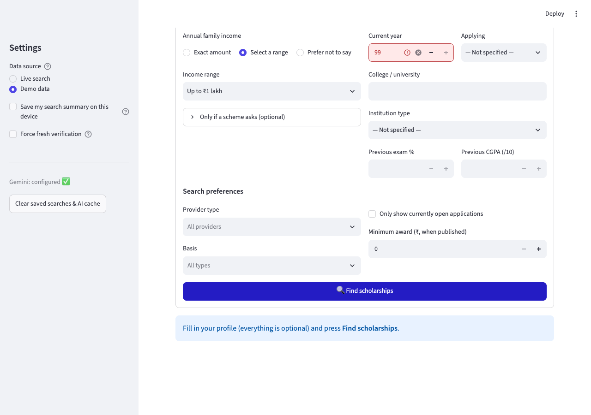
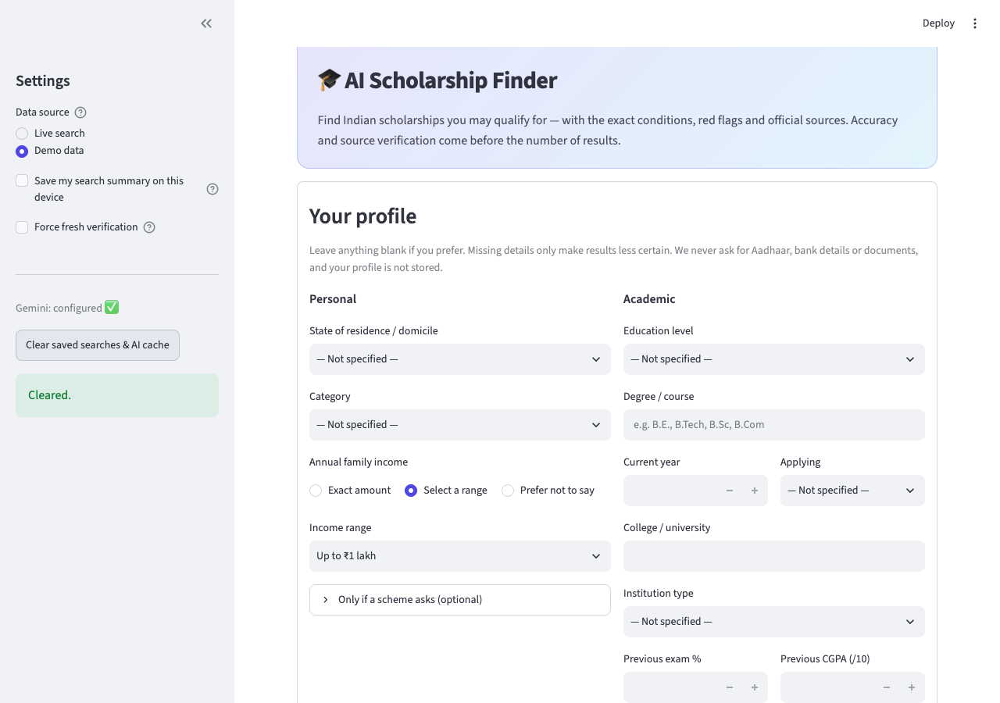
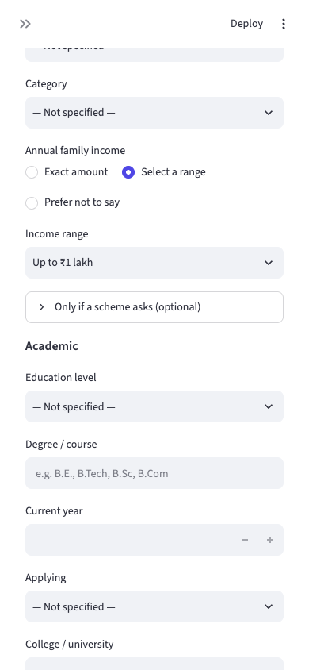
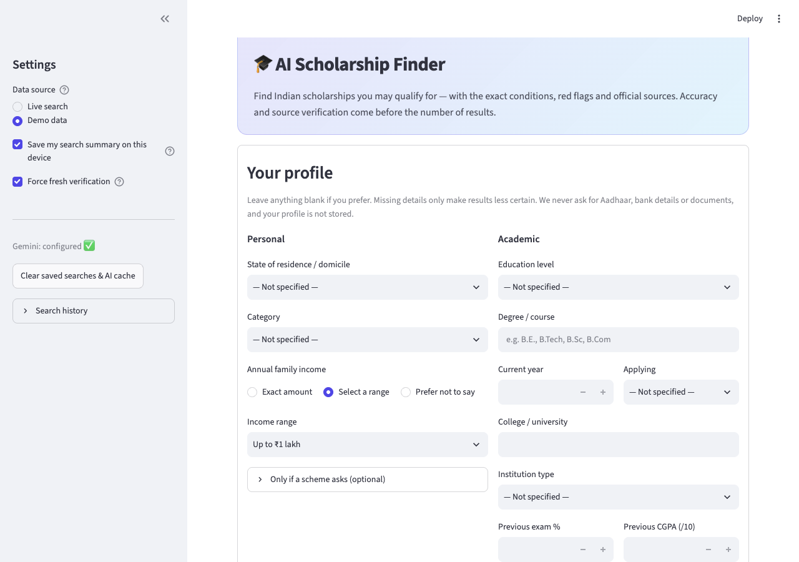
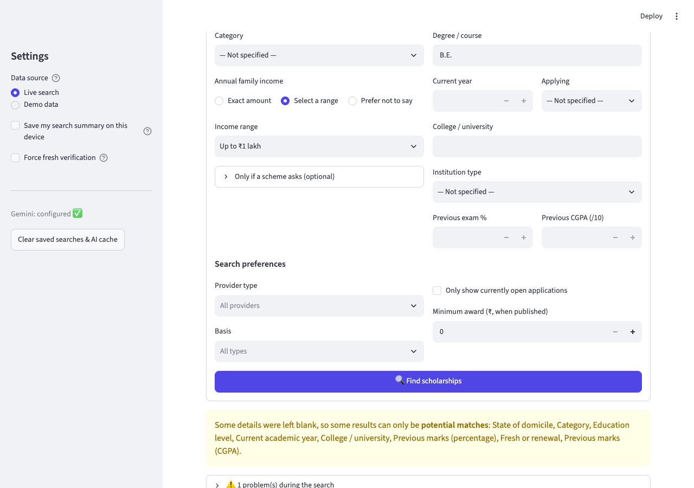

# MCP Testing Report - AI Scholarship Finder

Date: 2026-10-28    Application: Streamlit web app at http://localhost:8501    MCP server: @playwright/mcp@0.0.83

## 1. Objective

To show how the Model Context Protocol (MCP) can test the website: an MCP client sends tool calls to a Playwright MCP server, which controls a real Chromium browser. The client opens the site, clicks, types, reads the page and takes screenshots, then compares what it sees with the expected result.

## 2. How MCP testing works here

- Python MCP client (mcp_testing/mcp_harness.py) starts the server with 'npx @playwright/mcp' over stdio.
- The client lists the tools the server offers (25 tools, e.g. browser_navigate, browser_snapshot, browser_click, browser_type, browser_evaluate, browser_take_screenshot, browser_console_messages).
- browser_snapshot returns the page's accessibility tree; every element gets a ref id. The test finds the element by name and passes its ref to browser_click / browser_type.
- browser_evaluate reads page text and DOM facts (e.g. 'Showing 1 of 8', injected elements, page width).
- Each test case compares the observed result with the expected result and records PASS/FAIL plus a screenshot.
- Every MCP tool call is logged (name, arguments, duration, success) in mcp_testing/results.json.

## 3. Summary of results

MCP UI test cases executed: 16    Passed: 15    Failed: 1    MCP tool calls: 226

Existing automated suite (pytest): 175 passed, 1 skipped (the live test, run separately), 0 failed - covers eligibility rules, normalizer, red flags, ranking, repository, source safety, Gemini service (mocked), Streamlit AppTest flows.

## 4. MCP tools used

| MCP tool | Calls |
|---|---|
| browser_wait_for | 75 |
| browser_snapshot | 36 |
| browser_click | 30 |
| browser_evaluate | 20 |
| browser_resize | 17 |
| browser_navigate | 16 |
| browser_press_key | 13 |
| browser_take_screenshot | 12 |
| browser_type | 5 |
| browser_console_messages | 2 |

## 5. Test cases and results

| ID | Title | Steps (via MCP) | Expected | Actual | Result |
|---|---|---|---|---|---|
| TC-01 | Home page loads | Open http://localhost:8501; read title, text, console | Title 'AI Scholarship Finder', heading + Find button visible, 0 console errors | title='AI Scholarship Finder'; heading and Find button present; browser console errors: 0 | PASS |
| TC-02 | Initial empty state | Open page without searching | Prompt 'Fill in your profile…' is shown | Info prompt shown before any search | PASS |
| TC-03 | Demo search, empty profile | Select Demo data; click Find scholarships | 8 fictional cards, demo banner, 'Showing 8 of 8' | Demo banner shown; 8 cards labelled DEMO RECORD; 'Showing 8 of 8' present=True | PASS |
| TC-04 | Profile: Karnataka + OBC | Demo data; pick State=Karnataka, Category=OBC; search | Results and eligibility metrics render without errors | Results rendered for Karnataka/OBC: Showing 8 of 8; eligibility metrics visible | PASS |
| TC-05 | Text filter narrows list | Search demo; type 'Karnataka' in name filter | Count drops below 8 but stays >=1 | Text filter 'Karnataka' -> Showing 1 of 8 | PASS |
| TC-06 | Filter with no match | Type nonsense in name filter | Friendly 'No results match' warning | Warning 'No results match these filters' shown, no crash | PASS |
| TC-07 | Missing-field warning | Search with a blank profile | Warning lists blank details / potential matches | Warning about blank profile fields (potential matches only) displayed | PASS |
| TC-08 | Income input mode switch | Click radio 'Exact amount' | Exact-amount number box appears | DEFECT: after selecting 'Exact amount' the radio changed but the form still showed the 'Income range' dropdown; the 'Amount' box only appears after pressing Find (widgets inside st.form do not re-render until submit). See screenshot. | FAIL |
| TC-09 | HTML/script injection in text field | Enter <script> in course; search | Text escaped; nothing injected; no crash | Hostile HTML in course field: injected elements in DOM = 0; no dialog/crash | PASS |
| TC-10 | Out-of-range number | Type 99 in Current year; search | App does not crash | Out-of-range year (99) did not crash the app (Streamlit enforces max 8) | PASS |
| TC-11 | Gemini status indicator | Read sidebar | Shows configured / not-configured status | Sidebar status: Gemini: configured ✅ | PASS |
| TC-12 | Clear saved searches button | Click 'Clear saved searches & AI cache' | 'Cleared.' confirmation | Confirmation 'Cleared.' shown | PASS |
| TC-13 | Mobile layout (390x844) | Resize to phone size after search | No horizontal scrolling | Mobile 390px: scrollWidth=390, viewport=390 -> no horizontal scroll | PASS |
| TC-14 | Opt-in search history | Tick 'Save my search summary' | Search history panel appears | Opt-in history checkbox reveals the 'Search history' panel | PASS |
| TC-15 | Result cards show labels | Search demo; read cards | Eligibility status + DEMO label on each card | Cards show eligibility status and DEMO label | PASS |
| TC-16 | Live search against official sites | Live search; Karnataka, Undergraduate, B.E.; wait for completion | Real scholarships returned (or problems clearly reported), no crash | Live search finished: Showing 29 of 29; 1 problem(s) | PASS |

## 6. Evidence (screenshots taken through browser_take_screenshot)

TC-01 - Home page loads (PASS)

TC-03 - Demo search, empty profile (PASS)

TC-04 - Profile: Karnataka + OBC (PASS)

TC-05 - Text filter narrows list (PASS)

TC-06 - Filter with no match (PASS)

TC-08 - Income input mode switch (FAIL)

TC-09 - HTML/script injection in text field (PASS)

TC-10 - Out-of-range number (PASS)

TC-12 - Clear saved searches button (PASS)

TC-13 - Mobile layout (390x844) (PASS)

TC-14 - Opt-in search history (PASS)

TC-16 - Live search against official sites (PASS)

## 7. Failures and observations

- TC-08 Income input mode switch: DEFECT: after selecting 'Exact amount' the radio changed but the form still showed the 'Income range' dropdown; the 'Amount' box only appears after pressing Find (widgets inside st.form do not re-render until submit). See screenshot.
During test development the first runs failed because of problems in the test script, not the website (MCP element refs change after navigation; Streamlit radio inputs are covered by their labels so the label text must be clicked). These were fixed in the harness. Console check: ### Result Total messages: 28 (Errors: 0, Warnings: 28) Returning 0 messages for level "error"

Live-search note (TC-16): depends on internet, DuckDuckGo and official sites, so the result can vary between runs.

## 8. Conclusion

MCP lets an AI/automation client test the site the way a user does - through the real UI - without writing browser-specific code, and returns structured evidence (page snapshot, text, console, screenshots). It complements the 175 unit tests, which check the logic but not the rendered interface.

## Screenshots

**TC-01 Home page loads (PASS)**

**TC-03 Demo search, empty profile (PASS)**

**TC-04 Profile: Karnataka + OBC (PASS)**

**TC-05 Text filter narrows list (PASS)**

**TC-06 Filter with no match (PASS)**

**TC-08 Income input mode switch (FAIL)**

**TC-09 HTML/script injection in text field (PASS)**

**TC-10 Out-of-range number (PASS)**

**TC-12 Clear saved searches button (PASS)**

**TC-13 Mobile layout (390x844) (PASS)**

**TC-14 Opt-in search history (PASS)**

**TC-16 Live search against official sites (PASS)**

